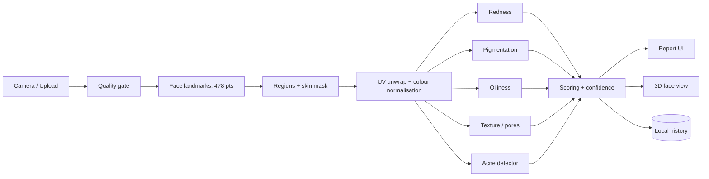

# DermaLens — Build Roadmap

> On-device face skin analysis for mobile web. Camera or upload → analysis → detailed visual report + 3D face view. **Photos never leave the device.**

**Status:** v0.6 draft · **Repo:** `github.com/vandit-bajaj/python-project` (new, empty) · **Host:** Vercel · **Built with:** Antigravity

Place this file at `docs/ROADMAP.md` in the repo and point agents at it.

---

## 1. Confirmed requirements

| Area | Requirement |
|---|---|
| Name | DermaLens |
| Platform | Web app, **optimised for mobile phones** |
| Input | Live camera or photo upload |
| Analysis | Acne, redness, pigmentation, oiliness, texture/pores, wrinkles, dark circles (**D1**, decided) |
| Product type | Free public product (**D3**, decided) |
| Languages | English only (**D6**) |
| Test devices | iPhone and Android (**D4**) |
| Report export | PDF, generated client-side (**D5**) |
| Distribution | Regular website, not an installable PWA (**D10**) |
| Capacity | Under 10 hours/week (**D7**) |
| Release | Everything ships together at v1.0, no staged public beta (**D13**) |
| Output | Detailed report, strong visuals, 3D model, minimalist design |
| Privacy | Photos stay on the user's device. No upload, no server-side image processing |
| Code quality | SDE3-style, latest best-in-class stack |
| Source | New empty GitHub repo, public, all rights reserved (**D12**) |
| Hosting | Vercel (see §10: recommend wiring it in Phase 0, not at the end) |
| Tooling | Antigravity |

Everything not in this table is either an **open decision (§2)** or an **engineering recommendation**. Recommendations are mine and can be vetoed; they are not claims about your requirements.

---

## 2. Open decisions

Nothing below is assumed. **D1–D7, D10, D12 and D13 were decided on 2026-11-04.** D8, D9 and D11 are still open. Phases marked ⚠ are blocked until the relevant decision is answered.

| ID | Question | Why it matters | Blocks | Answer |
|---|---|---|---|---|
| D1 | Which skin concerns must v1 cover? | Sets analyzer and ML effort; wrinkles/pores/dark circles are much less reliable from a selfie | — | **Decided:** all of them: acne, redness, pigmentation, oiliness, texture/pores, wrinkles, dark circles |
| D2 | Acne detection: train own model, use a pretrained one, or classical CV first? | Biggest effort and risk item in the project | — | **Decided:** classical CV first, ML later |
| D3 | Is DermaLens a portfolio project, a free public product, or commercial? | Dataset and model licences (many skin datasets restrict commercial use; Ultralytics YOLO is AGPL-3.0), legal review | — | **Decided:** free public product |
| D4 | Which phones will you test on (iOS / Android / models)? | Support matrix, perf budgets, "mid-range reference device" | — | **Decided:** both iPhone and Android (exact models and OS versions go in `docs/devices.md` in Phase 0) |
| D5 | Report export: none, PDF, shareable image, or both? | Client-side export libraries, share UX | — | **Decided:** PDF (client-side) |
| D6 | Languages: English only, or more (e.g. Hindi)? | i18n is far cheaper to set up on day 1 | — | **Decided:** English only |
| D7 | Hours per week / target launch date? | Converts relative effort into a calendar | — | **Decided:** under 10 hours/week, no fixed launch date (see §9 calendar) |
| D8 | Custom domain? | Vercel config, OG images, brand | P8 | |
| D9 | Target market (India-first, global)? | Evaluation-set composition, privacy-law scope (DPDP vs GDPR) | P4, P8 | |
| D10 | Installable PWA / offline use? | Service worker, model caching, Safari storage eviction (see P7) | — | **Decided:** regular website only, no PWA or offline mode |
| D11 | Analytics / error tracking at all? | Any telemetry must be provably free of face data | P8 | |
| D12 | Repo visibility and source licence: public open-source (which licence), public all-rights-reserved, or private? | LICENSE file, what is safe to commit (fixtures, models), detector licence compatibility later | — | **Decided:** public repo, all rights reserved |
| D13 | Release strategy at under 10 h/week: public beta at Milestone 3 then iterate, ship everything at once, or cut scope? | Calendar, what "v1" means, risk of a long stretch with nothing public | — | **Decided:** ship everything at once at v1.0 (no public beta) |

---

## 3. Principles and non-goals

**Principles**
1. **On-device by construction.** The architecture and CSP make uploading images impossible, not merely unlikely.
2. **Honest measurement.** Outputs are *indices with confidence*, not diagnoses.
3. **Mobile-first.** Design, performance budgets and QA start from a phone, not a desktop.
4. **Pure, testable analyzers.** Analysis code has no React or DOM dependency.
5. **Progressive loading.** Heavy dependencies (ML runtime, 3D) load only when needed.
6. **Versioned everything.** Models, analyzers and result schemas carry versions.
7. **Minimal UI.** One accent colour, generous space, restrained motion.

**Non-goals (v1):** medical diagnosis or treatment advice, accounts or cloud sync, server inference, social features, product sales.

---

## 4. Architecture



**Key design decision:** every analyzer outputs its result map in **canonical face-UV space**. One representation then feeds the 2D heatmap overlays, the 3D heatmap texture and the per-region scores, with no duplicated geometry code.

**Threading:** main thread = UI + 3D. A Web Worker (typed RPC via Comlink) runs landmarks, analyzers and ONNX inference on `OffscreenCanvas`/`ImageBitmap`. The UI never blocks on analysis, and results stream to the report as each analyzer finishes.

**Analyzer contract (sketch):**

```ts
export interface Analyzer<R extends AnalysisResult> {
  readonly id: string;
  readonly version: string;
  analyze(input: AnalyzerInput, signal?: AbortSignal): Promise<R>;
}
```

### Repo layout (monorepo)

```
.agent/{rules,workflows,skills}
apps/web                 # Next.js app (Vercel root directory)
packages/analysis-core   # pure TS: regions, colour, analyzers, scoring
packages/ui              # design system + Storybook
packages/models          # ONNX/landmarker assets + versioned manifests
ml/                      # Python training/eval (deferred: D2 = classical CV first)
docs/{ROADMAP.md,adr/}
fixtures/                # synthetic or consented images only
```

### Stack (pin exact versions at scaffold time and verify against current docs)

| Layer | Choice | Notes |
|---|---|---|
| Framework | Next.js 16.x (App Router), React 19, strict TypeScript | Current major line; pin latest stable at scaffold |
| Styling / UI | Tailwind v4, shadcn/ui (Radix), `vaul` bottom sheets, Motion | Mobile patterns: bottom sheets, thumb-reachable CTAs |
| Face tracking | `@mediapipe/tasks-vision` Face Landmarker | 478 landmarks, 52 blendshapes, head-pose matrix, WASM in browser |
| Custom models | `onnxruntime-web` (WebGPU, WASM fallback) | In worker; needed from Phase 4b (v1 analyzers are classical) |
| 3D | three.js + React Three Fiber (v9+ for React 19) + drei | WebGL2 default; WebGPU renderer behind a flag only |
| Charts | Custom SVG + `d3-scale` / `d3-shape` | No heavy chart library |
| State / validation | Zustand, Zod | Zod at every boundary and on stored data |
| Storage | Dexie (IndexedDB) | Local-first history |
| Worker RPC | Comlink | Typed |
| Tooling | pnpm workspaces, Turborepo, Biome, lefthook, commitlint | |
| Testing | Vitest, Testing Library, Playwright (Chromium + WebKit, mobile viewports), Storybook, axe-core, Lighthouse CI | |
| ML (offline) | `uv`, PyTorch, ONNX export, `onnxruntime` parity tests | Deferred to Phase 4b; detector family depends on D3/D12 licensing |
| CI/CD | GitHub Actions → Vercel | Preview per PR |

---

## 5. Mobile-first spec

**Devices and browsers:** you test on both iPhone and Android (**D4**); iOS Safari and Android Chrome are the baseline. Record exact models, OS versions and browsers in `docs/devices.md` and mark one mid-range device per platform as the *reference device*.

**Camera**
- Front camera via `getUserMedia`, ideal 1080p; `playsInline`, `muted`; mirror the preview but not the analysed frame.
- Stop all tracks on unmount, on `visibilitychange` (hidden) and on route change, so the camera light turns off.
- Handle permission states explicitly: prompt, denied, blocked in settings, no camera, camera in use, orientation change.
- Respect safe-area insets, use `100dvh`, 44 px minimum touch targets, no hover-only affordances.

**Upload**
- Fix EXIF orientation and downscale the long edge to a fixed cap (proposed 1600–2048 px) before analysis. iOS usually hands the page a JPEG, so add a HEIC/HEIF decoder fallback only if device testing shows it is needed, and check its licence first (libheif-based decoders are LGPL; see D12).

**Performance budgets (proposed starting targets, validate in Phase 0 on D4 devices)**

| Metric | Target |
|---|---|
| Landing LCP | ≤ 2.5 s, mid-range Android, throttled 4G |
| Initial JS | ≤ 150 KB gzip (landing, before any scan) |
| Lazy-loaded | MediaPipe, ORT, three.js load only after the user starts a scan / opens 3D |
| Model payload | Landmarker a few MB; ML acne model (Phase 4b) ≤ 10 MB quantised (proposed) |
| Live guidance | ≥ 15 FPS |
| Still analysis (end to end) | ≤ 3–4 s |
| 3D view | ≥ 30 FPS, DPR capped, frame-on-demand |
| INP / CLS | ≤ 200 ms / ≈ 0 |

**Resilience:** iOS may kill memory-heavy tabs, so keep peak memory low, release bitmaps promptly and handle worker restarts. Thermal throttling means adaptive quality in the live loop and 3D.

---

## 6. Analysis methodology

Raw outputs are **relative indices per region, with a confidence value derived from the capture-quality report**. They are labelled as indices in the UI until calibrated against a diverse reference set.

| Analyzer | Method | Known failure modes |
|---|---|---|
| Redness | sRGB → linear → CIELAB; adaptive threshold on a\* within the skin mask (per-person baseline); area fraction + intensity | Colour cast, warm lighting, flushing, sunburn |
| Pigmentation | L\* and ITA° for tone; dark-spot detection via difference-of-Gaussians inside the mask; melanin-index proxy from log(R/G) | Shadows, makeup, facial hair |
| Oiliness | Specular highlight detection: high L\*, low chroma, T-zone weighting | Flash, glossy lighting, sweat vs oil |
| Texture / pores | High-frequency energy (Laplacian / Gabor / LBP) at a fixed *physical* scale | Blur, JPEG compression, sensor noise |
| Wrinkles | Ridge filters (Frangi) in periorbital/forehead regions | Lower reliability from selfies; expression, lighting angle (lower-confidence tier) |
| Dark circles | Periorbital L\*/chroma vs cheek reference | Shadows, eye bags vs pigment (lower-confidence tier) |
| Acne (v1, classical) | Blob/DoG detection on the redness and local-contrast maps at plausible lesion sizes (mm via iris scale) → estimated lesion count, density per region, severity band; an ML detector slots in later behind the same interface | Scars/marks vs lesions, makeup, low contrast on darker skin, hair; lower accuracy than a trained model |

**Scale normalisation:** use iris landmarks (average human iris diameter is a usable approximate reference) to estimate px-per-mm, so texture and lesion sizes mean the same thing at any camera distance.

**Evaluation plan (no ground truth is available for most indices, so test properties instead):**
- *Synthetic perturbation:* inject redness/spots/blur into fixtures; scores must respond monotonically.
- *Test–retest:* repeated captures of one face give low variance.
- *Cross-lighting stability:* same face, different lighting, bounded drift (and confidence drops when lighting is bad).
- *Per-skin-tone reporting:* Fitzpatrick I–VI results for every shipped model, published on the "How DermaLens measures" page.
- *Acne (classical v1):* agreement with human-annotated lesion counts on a small, consented, skin-tone-diverse set; report error per Fitzpatrick group. When the ML detector arrives: mAP/F1 on a person-level held-out split (no identity leakage).
- *Darker skin tones:* colour-based redness and acne cues are weaker on darker skin. Treat this as a first-class requirement: thresholds validated per group, reduced confidence where the signal is weak, and the limitation stated on the measurement page.

---

## 7. Privacy, security, compliance

- **Enforced on-device:** strict CSP with `connect-src 'self'`; nonce-based `script-src` plus `'wasm-unsafe-eval'` for WASM; `worker-src 'self' blob:`; `img-src 'self' data: blob:`; self-hosted fonts and models. A Playwright test **fails if any non-same-origin request occurs during a scan**.
- `Permissions-Policy: camera=(self), microphone=(), geolocation=()`.
- Cross-origin isolation (COOP/COEP) only if threaded WASM is needed. It forces everything to be same-origin or CORP-tagged, so it's another reason to self-host.
- **No face data in logs, errors or analytics.** Scrub breadcrumbs; no session replay. Telemetry per **D11**.
- **Local storage:** results by default; a low-res thumbnail only if the user opts in. "Delete all my data" always available; JSON export/import.
- **Consent and copy:** pre-camera explainer ("processed on your phone, never uploaded"); cosmetic, not diagnostic; suggest a dermatologist for concerning lesions; avoid words like "diagnose" and "treat".
- **Law:** DermaLens is a free *public* product, so the privacy policy, consent copy and disclaimers need review before launch. With on-device processing and no collection, obligations are lighter (DPDP Act for India; GDPR if global), but not zero. Scope per **D9**.
- **Datasets and models:** record every dataset's licence in `ml/DATASETS.md` and check it against D3 (free public product) and D12; ship a model card per model (data, per-skin-tone metrics, limitations).
- **Fixtures policy:** only synthetic or explicitly consented faces in the repo; datasets are git-ignored.
- **Supply chain:** exact version pins, frozen lockfile in CI, Dependabot/Renovate, `pnpm audit` and a dependency-licence gate in CI.

---

## 8. Antigravity operating guide

Antigravity has an **Editor view** (normal coding) and a **Manager view** (spawn and supervise parallel agents, review their Artifacts). Rules, workflows and skills make agents behave consistently. Verify the folder paths against current Antigravity docs at setup.

**Rules** — `.agent/rules/*.md` (workspace). Personal preferences go in `~/.gemini/GEMINI.md`.

| File | Contents |
|---|---|
| `00-project-context.md` | What DermaLens is; on-device and mobile-first constraints; pointer to `docs/ROADMAP.md` |
| `10-architecture.md` | Dependency direction (`analysis-core` ← `ui` ← `web`); analyzer interface; worker boundary; UV-space outputs |
| `20-code-standards.md` | Strict TS, no `any`, Zod at boundaries, small modules, named exports, error handling conventions |
| `30-privacy-security.md` | No network calls with image data, no logging of images, CSP rules, fixtures policy, no new dependency without an ADR line |
| `40-mobile-performance.md` | Budgets from §5, lazy-loading rules, DPR caps, memory hygiene |
| `50-testing.md` | Test pyramid, golden-image conventions, synthetic-perturbation tests, fake-camera setup |
| `60-design-system.md` | Tokens, spacing, accessibility (WCAG AA), reduced motion, heatmap colour rules |
| `70-git-workflow.md` | Branch naming, conventional commits, PR template, required checks |

**Workflows** — `.agent/workflows/` (invoked with `/`): `/new-analyzer`, `/new-screen`, `/add-adr`, `/perf-check`, `/privacy-audit`, `/pre-pr`.

**Skills** — `.agent/skills/`: `analyzer-authoring` (contract, fixtures, tests), `mobile-camera-qa` (device checklist, fake-camera flags).

**How to work**
1. Give each run a bounded task (one package or one feature slice) so runs stay cheap and reviewable.
2. Ask for a **plan artifact first**, approve it, then implement, then verify with tests plus screenshots at 390×844 and 360×800.
3. Review policy: **manual plan approval** for Phases 0, 2, 3, 4 (architecture and correctness-critical); more autonomy for UI work in Phases 5–6, but require screenshot/recording artifacts.
4. Chromium can use fake camera flags (`--use-fake-device-for-media-stream --use-file-for-fake-video-capture=<file>`) for automated camera tests; WebKit has no equivalent, so **iOS Safari needs manual device testing**.
5. Parallelise in Manager view only across different packages, one branch per agent (see each phase).

---

## 9. Phases

Effort is S/M/L per phase. With **D7 = under 10 hours/week**, the calendar below converts effort into hours and weeks.

#### Calendar at under 10 hours/week

These are my rough estimates, assuming agent-assisted development. Recalibrate after Phase 1 using your real hours.

| Phase | Effort | Est. hours |
|---|---|---|
| P0 Foundations | S | 10–15 |
| P1 Capture and quality gate | M | 20–30 |
| P2 Geometry and regions | M | 20–30 |
| P3 Analyzers v1 | L | 45–65 |
| P4 Acne (classical) | M | 20–30 |
| P5 Report + PDF | L | 40–55 |
| P6 3D view | M | 20–30 |
| P7 Local history | M | 15–25 |
| P8 Hardening and launch | M | 20–30 |
| **Total** | | **210–310** |

Suggested milestones (cumulative):

| Milestone | Phases | Hours | Weeks at 10 h/wk | Weeks at 6 h/wk |
|---|---|---|---|---|
| M1 Foundations and capture | P0–P2 | 50–75 | 5–8 | 8–13 |
| M2 Analysis | + P3, P4 | 115–170 | 12–17 | 19–28 |
| M3 Report + PDF (**private testing starts**) | + P5 | 155–225 | 16–23 | 26–38 |
| M4 3D + history | + P6, P7 | 190–280 | 19–28 | 32–47 |
| M5 Hardening and launch (v1.0) | + P8 | 210–310 | 21–31 | 35–52 |

Full v1 is therefore roughly 5–7 months at 10 hours/week and 8–12 months at 6 hours/week. If that is too long, the candidate scope cuts, least value lost first: wrinkles and dark circles, then Phase 7 (history is fragile on iPhone without a PWA), then 3D. D13 = ship everything at once, so these cuts are a fallback if the calendar slips, not the plan. Nothing goes public before M5; M3 is where private testing starts.

### Phase 0 — Foundations and repo bootstrap · Effort S

**Goal:** a deployable, production-grade empty skeleton with every guardrail in place.

- [ ] *(Recommended)* rename the GitHub repo `python-project` → `dermalens` and update the local remote.
- [ ] pnpm workspace + Turborepo; Node LTS pinned (`.nvmrc`, `engines`, `packageManager`).
- [ ] Scaffold `apps/web` (Next.js, strict TS, Tailwind v4, shadcn/ui) and stub `packages/*`.
- [ ] Biome, Vitest, Playwright (Chromium + WebKit, mobile viewports), Storybook, lefthook + commitlint.
- [ ] GitHub Actions: frozen install, typecheck, lint, unit, build, Playwright smoke, bundle-size check.
- [ ] Dependency-licence gate in CI: allow permissive licences (MIT, Apache-2.0, BSD, ISC), block GPL/AGPL, review LGPL/MPL case by case. Needed because the repo is public and all rights reserved (D12).
- [ ] Public-repo hygiene: secret scanning on; no real face images or datasets committed (`.gitignore` + pre-commit check); `fixtures/` synthetic or explicitly consented only.
- [ ] Vercel: connect repo, Root Directory `apps/web`, preview deploys; confirm the camera permission prompt works on a real phone via the preview URL.
- [ ] Record test devices (model, OS, browser) in `docs/devices.md`; pick one mid-range reference device per platform and capture baseline benchmarks on it.
- [ ] Security headers and CSP in place from day one; self-hosted fonts; `X-Robots-Tag: noindex` until launch (D13).
- [ ] Design tokens (colour, type, spacing, radius, motion) as CSS variables; light/dark; safe-area and `100dvh` base layout.
- [ ] English only (D6): no i18n framework; keep all user-facing copy in one `content` module so extraction stays easy later.
- [ ] `.agent/` rules and workflows; ADR-001 on-device architecture, ADR-002 analyzer interface, ADR-003 worker boundary, ADR-004 state and storage.
- [ ] README, CONTRIBUTING, PR template, and a `LICENSE` file with an "All rights reserved" copyright notice (D12). This is not an open-source licence, so the README says plainly that the code can be viewed but not reused. CONTRIBUTING states the contribution policy. No `ml/` yet (D2 = classical first).

**Agents:** write rules and ADRs first (serial), then in parallel: A = monorepo + CI, B = tokens + base UI + Storybook.
**Acceptance:** `main` deploys; each PR gets a preview; CI green; Lighthouse mobile ≥ 95 on the skeleton; the "no external requests" check passes.

> **Prompt:** Read `docs/ROADMAP.md` §3–§5 and §9 Phase 0 and `.agent/rules`. Produce a plan artifact for the monorepo skeleton. Do not implement until I approve. Do not add dependencies not listed in §4.

### Phase 1 — Mobile capture and quality gate · Effort M

**Goal:** reliable capture on real phones, with a gate that blocks bad input.

- [ ] Permission primer ("processed on your phone"), plus denied / blocked / no-camera recovery states.
- [ ] Camera pipeline per §5; clean teardown; orientation handling.
- [ ] Face-guide overlay with live, specific feedback ("move closer", "face the light", "hold still").
- [ ] Quality checks: single face present; size/distance; yaw/pitch/roll (from the transformation matrix); blur (Laplacian variance); exposure (histogram clipping); colour cast (gray-world deviation); neutral expression (blendshapes); occlusion/glasses (best-effort).
- [ ] Auto-capture after N consecutive good frames, plus a manual shutter fallback.
- [ ] Upload path with EXIF fix, downscale and the same gate, with actionable messages (HEIC fallback only if testing shows a need).
- [ ] `CapturedFrame { bitmap, size, source, qualityReport }` held in memory only.

**Agents:** A = camera + permissions, B = quality-gate metrics (pure functions in `analysis-core`).
**Acceptance:** works on iOS Safari and Android Chrome (D4 devices); gate rejects blurry/dark/profile/occluded fixtures and accepts good ones; heap stable over 20 captures; camera light off after leaving the flow.

> **Prompt:** Implement the capture flow per Phase 1. Quality checks are pure functions in `analysis-core` with unit tests on fixtures. Plan artifact first. Verify at 390×844 and 360×800.

### Phase 2 — Face geometry and region engine · Effort M

**Goal:** turn a capture into stable, scale-normalised regions, a clean skin mask and a canonical UV texture.

- [ ] Worker + Comlink; Face Landmarker in IMAGE mode (stills) and VIDEO mode (live); self-hosted, versioned model assets with a progress UI and caching.
- [ ] Region maps by landmark indices: forehead, cheeks, nose, chin, perioral, under-eyes, T-zone, U-zone. Dev-only `/debug/regions` visualiser.
- [ ] Skin mask: landmark polygon minus eyes, brows, lips, nostrils; refine with colour segmentation to drop hair, beard, glasses; morphological cleanup and feathering.
- [ ] Scale normalisation via iris landmarks (px → approximate mm).
- [ ] Canonical UV unwrap using the face-mesh triangulation (feeds the 3D phase too).
- [ ] Colour pipeline: sRGB → linear → Lab; white-balance and exposure normalisation; documented.

**Agents:** A = worker + landmarks, B = regions + mask, C = colour pipeline (separate packages/folders).
**Acceptance:** regions stable across repeated captures (IoU target set after baseline); unwrap round-trips; the mask excludes eyes, lips and hair on the fixture set; within the time budget.

> **Prompt:** Plan the geometry engine per Phase 2 with all outputs expressed in canonical UV space. Include a debug visualiser. No React in `analysis-core`.

### Phase 3 — Analyzers v1 (classical CV) · Effort L (largest phase)

**Goal:** well-tested analyzers for every D1 concern except acne (Phase 4).

- [ ] Use `/new-analyzer` for each: redness, pigmentation, oiliness, texture/pores, wrinkles, dark circles. Ship in two tiers: **core** (redness, pigmentation, oiliness, texture/pores) and **lower-confidence** (wrinkles, dark circles), shown with a "beta" label and confidence reduced by pose, lighting angle and expression.
- [ ] Output schema per analyzer: per-region score (0–100), UV-space map, confidence, analyzer version.
- [ ] Scoring layer: aggregate per concern and overall; confidence from the quality report; UI labels "relative index" until calibrated.
- [ ] Synthetic-perturbation, test–retest and cross-lighting tests (§6).
- [ ] Benchmarks inside the worker on D4 devices.

**Agents:** one per analyzer, in parallel, each on its own branch.
**Acceptance:** monotonic response to perturbations; test–retest variance within an agreed bound; stable across lighting; within budget on the mid-range device.

> **Prompt:** Run `/new-analyzer` for `<analyzer>` per §6. Write the failing perturbation tests first. Plan artifact first.

### Phase 4 — Acne detection (classical v1, ML later) · Effort M

**Goal:** a transparent on-device acne estimator now, with a clean seam for a trained model later.

**v1 (classical):**
- [ ] Candidate generation: blob/DoG detection on the redness map and local-contrast map inside the skin mask, at lesion sizes scaled by iris-based px-per-mm.
- [ ] Filtering: shape/size/contrast rules; suppress hairs, moles, scars, lips, nostril edges and specular highlights.
- [ ] Output: estimated lesion count and density per region, severity band, UV-space lesion map, confidence. Wording is "estimated blemishes", never a diagnosis.
- [ ] Same `Analyzer` interface as the others, with synthetic-lesion tests (inject lesions of known size and position; count and location recovered within tolerance).
- [ ] Per-skin-tone threshold validation and reduced confidence where contrast is weak.

**ML later (Phase 4b, after v1):** a drop-in detector behind the same interface, built in `ml/` (Python). Prerequisites:
- Dataset audit with licence check. "Free public product" is still a public deployment, and many skin datasets restrict commercial or redistributed use (verify each licence at the time; scope per D9 and legal review).
- Person-level splits, skin-tone-balanced evaluation, quantised ONNX through ORT-web (WebGPU → WASM fallback), PyTorch ↔ ORT parity test, model card.
- Detector family: with a public, all-rights-reserved repo (D12), AGPL-licensed options (e.g. Ultralytics YOLO) conflict with the licence model. Use permissively licensed families (e.g. YOLOX; verify at the time).

**Acceptance (v1):** perturbation tests pass; per-tone error reported; within the time budget on the D4 reference device; limitations documented on the measurement page.

> **Prompt:** Implement the classical acne estimator per Phase 4 behind the `Analyzer` interface. Write the synthetic-lesion tests first. Plan artifact first.

### Phase 5 — Report and visualisation system · Effort L

**Goal:** a best-in-class, minimalist, mobile-first report.

- [ ] Vertical "story" layout: header (summary + confidence) → concern cards (score, severity, region breakdown, plain-language meaning, general care guidance, when to see a dermatologist) → heatmap viewer (original/overlay slider, concern chips) → region map with score chips → capture-quality and confidence → methodology and limitations → actions.
- [ ] Visual system: neutral palette + one accent; perceptually uniform, colour-blind-safe heatmap colour maps (not red-only); animated SVG score rings; reduced-motion respected.
- [ ] Components in `packages/ui` with Storybook stories and automated a11y checks; charts from `d3-scale/shape`.
- [ ] Progressive render as analyzers finish; skeleton loaders.
- [ ] PDF export (D5), fully client-side: render the report to a print-ready PDF in the browser with a lazy-loaded library, including heatmap images, scores and the limitations text. Test the download flow on iOS Safari and Android Chrome, where file handling differs.
- [ ] Copy lives in the single `content` module (English only, D6) and is reviewed for non-diagnostic language.
- [ ] Start private testing with a small, consented group covering varied skin tones, phones and lighting. Collect feedback outside the app (the app collects nothing), and log per-skin-tone observations for the measurement page.

**Agents:** A = report layout, B = heatmap viewer, C = score/ring/chart primitives.
**Acceptance:** Lighthouse a11y ≥ 95; AA contrast including legends; works from 320 px to tablet widths; charts have text alternatives.

> **Prompt:** Plan the report screen at 390 px first. Reuse tokens from `packages/ui`; attach screenshots at 360×800 and 390×844 as artifacts.

### Phase 6 — 3D face view · Effort M

**Goal:** an approximate 3D face with heatmap layers that stays smooth on phones.

- [ ] Mesh from the canonical face-mesh topology; vertices from landmarks with depth smoothing; UVs from the canonical UV map.
- [ ] Albedo = unwrapped face texture (Phase 2); per-concern heatmap layers blended in shader; layer toggles; original ↔ overlay slider.
- [ ] Edge fade so it doesn't read as a cut-out mask.
- [ ] Touch orbit with **limited azimuth** (a single photo gives frontal data only), pinch zoom, tap-region highlight, double-tap reset.
- [ ] Perf: DPR cap, frame-on-demand, dynamic resolution, dispose resources, WebGL context-loss handling, lazy-loaded chunk; static fallback if WebGL is unavailable.
- [ ] Label "approximate 3D from a single photo".

**Acceptance:** ≥ 30 FPS on the mid-range device; memory stable over repeated open/close; overlay alignment verified against landmark overlay.

> **Prompt:** Plan the 3D view per Phase 6. three.js chunk must be lazy-loaded. Include a perf trace artifact on the reference device.

### Phase 7 — Local history and progress · Effort M

**Goal:** private, local-first tracking over time.

- [ ] Dexie schema with versioned migrations; Zod-validated, schema-versioned results; optional low-res thumbnail (opt-in).
- [ ] Timeline UI, side-by-side compare, delta heatmaps, trend charts; warn when lighting/quality differs between scans.
- [ ] Delete one/all, JSON export/import, `navigator.storage.persist()`, quota handling.
- [ ] **Safari caveat:** Safari can evict site storage after roughly a week without use (installed home-screen apps are exempt, but D10 = regular website). Treat local history as best-effort on iPhone: surface JSON export prominently and warn users that history can be cleared.
- [ ] Results are tagged with analyzer/model versions; cross-version comparisons are flagged.

**Acceptance:** migrations tested; import/export round-trips; quota and eviction paths handled.

> **Prompt:** Plan the local data layer per Phase 7. Schema first, with migration tests. No network access.

### Phase 8 — Hardening and launch · Effort M

- [ ] Real-device performance pass; bundle analysis; Lighthouse CI budgets enforced.
- [ ] Accessibility audit with VoiceOver and TalkBack, plus keyboard on desktop.
- [ ] Security: CSP verified, header scan, dependency audit, the zero-outbound-request Playwright test green.
- [ ] Reliability: error boundaries, worker crash recovery, model-load failure, camera errors, low-memory handling. No offline mode or service worker (D10 = regular website); model files rely on immutable HTTP caching.
- [ ] Legal/content: disclaimer placement, plain-language privacy policy, terms, consent copy; review per D3/D9.
- [ ] Public "How DermaLens measures" page with limitations and per-skin-tone results.
- [ ] Device matrix pass per D4.
- [ ] Release: production domain (D8), OG images, favicons, robots, 404, remove the pre-launch `noindex`, Vercel instant-rollback plan, telemetry per D11, `v1.0.0` tag and CHANGELOG.

---

## 10. Git, CI/CD and Vercel

**Git:** `main` protected; branches `feat/p<phase>-<slug>`; conventional commits; squash-merge PRs; PR template includes perf impact, privacy impact, screenshots at both mobile viewports. One branch per parallel agent, merged in dependency order.

**Required checks:** typecheck, Biome, unit tests, build, Playwright smoke (Chromium + WebKit), bundle-size budget, zero-outbound-request test, dependency-licence gate.

**Vercel:**
- Framework: Next.js · Root Directory: `apps/web` · enable including source files outside the root directory (workspace packages).
- Install: `pnpm install --frozen-lockfile` · Build: `pnpm turbo build --filter=web`.
- Ignored build step: skip when only `ml/` or `docs/` changed.
- Env vars: none expected (no backend).
- Headers: CSP, `Permissions-Policy`, `Referrer-Policy`, `X-Content-Type-Options`; model files with long immutable cache and versioned filenames; COOP/COEP only if threaded WASM is adopted.
- **Why wire it up in Phase 0:** camera behaviour differs per phone, and preview URLs are the cheapest way to test every PR on real devices over HTTPS.

**Pre-launch visibility (D13: nothing public until v1.0):**
- Keep the production domain unannounced and unlinked, and send `X-Robots-Tag: noindex` until launch.
- Check Vercel's Deployment Protection settings and confirm exactly which URLs are publicly reachable before sharing any link.
- The GitHub repo is public, so the README should say the project is not yet released.
- Share preview links only with private testers (from M3 on).

---

## 11. v1 definition of done

- [ ] All D1 analyzers shipped, tested and within perf budgets on the D4 reference device (wrinkles and dark circles labelled lower-confidence)
- [ ] Classical acne estimator shipped with documented limitations and per-skin-tone error reporting
- [ ] Report and 3D view meet Phase 5/6 acceptance on iOS Safari and Android Chrome
- [ ] Zero outbound requests during a scan (automated)
- [ ] Lighthouse mobile ≥ 90 (performance), ≥ 95 (accessibility)
- [ ] Consent, disclaimer, privacy policy and "How DermaLens measures" page live
- [ ] Data export and delete-all working
- [ ] CI green, ADRs current, README accurate, `v1.0.0` tagged and deployed on Vercel

---

## 12. Backlog (post-v1)

Guided multi-angle capture for better 3D; routine and progress insights; dermatologist-share export; undertone/skin-type analysis; additional languages; Capacitor wrapper for app stores; optional on-device plain-language summaries (only if mobile performance allows).

---

## 13. Decision log

| Date | Decision | Notes |
|---|---|---|
| 2026-11-04 | D1 | All concerns: acne, redness, pigmentation, oiliness, texture/pores, wrinkles, dark circles |
| 2026-11-04 | D2 | Classical CV first, ML later |
| 2026-11-04 | D3 | Free public product |
| 2026-11-04 | D4 | Both iPhone and Android; exact models and OS versions to be recorded in docs/devices.md |
| 2026-11-04 | D5 | PDF export, client-side |
| 2026-11-04 | D6 | English only |
| 2026-11-04 | D7 | Under 10 hours/week, no fixed launch date |
| 2026-11-05 | D8 | dermalens.vercel.app (default Vercel domain for v1.0) |
| 2026-11-05 | D9 | India-first focus (Fitzpatrick IV–VI calibration, high UV/humidity context) |
| 2026-11-04 | D10 | Regular website only, no PWA or offline mode |
| 2026-11-05 | D11 | Strict zero telemetry (0 scripts, 0 cookies, 0 trackers) |
| 2026-11-04 | D12 | Public repo, all rights reserved |
| 2026-11-04 | D13 | Ship everything at once at v1.0, no staged public beta |
